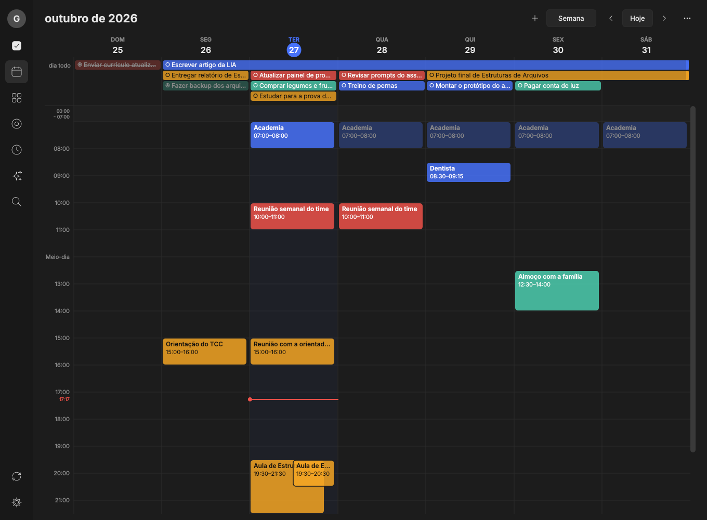
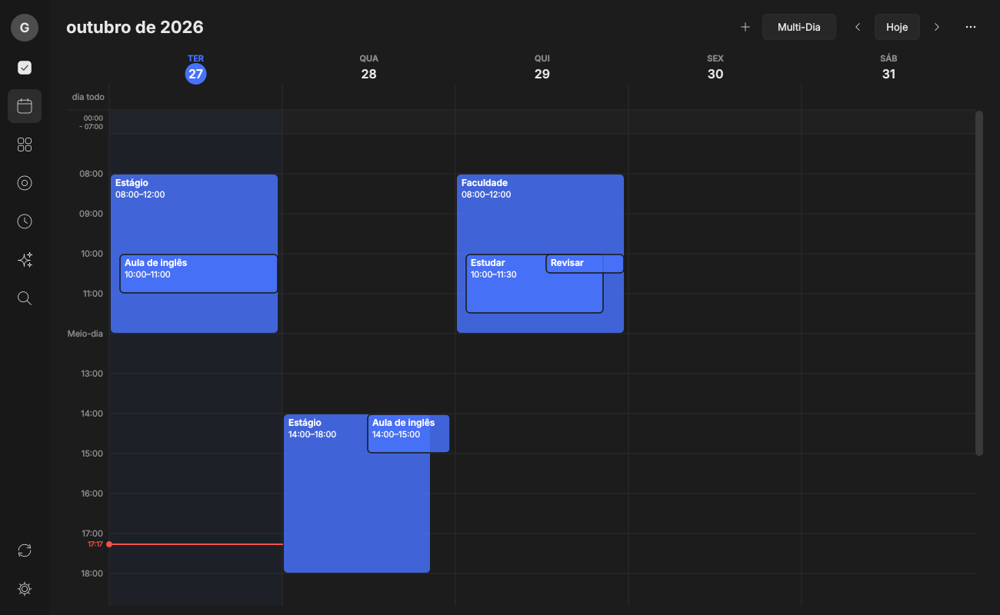
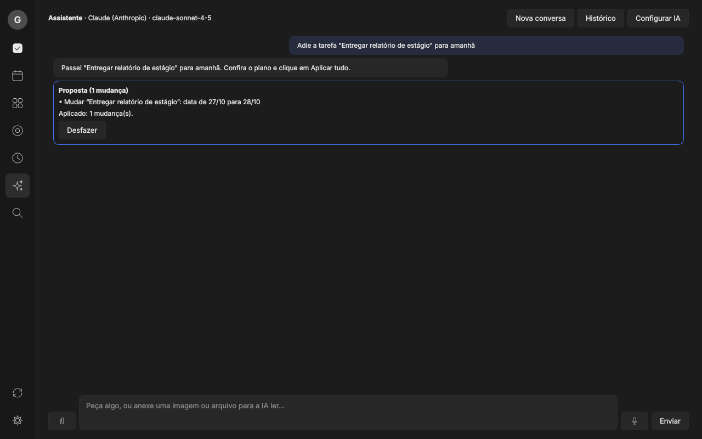
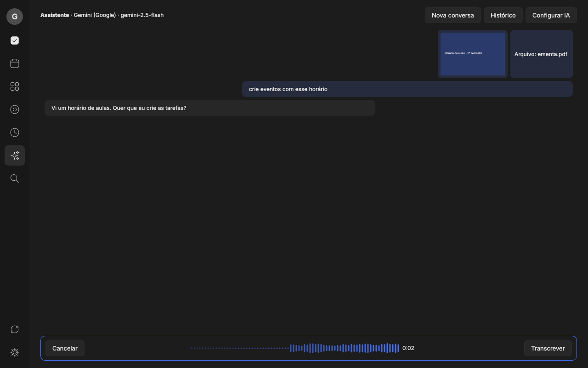
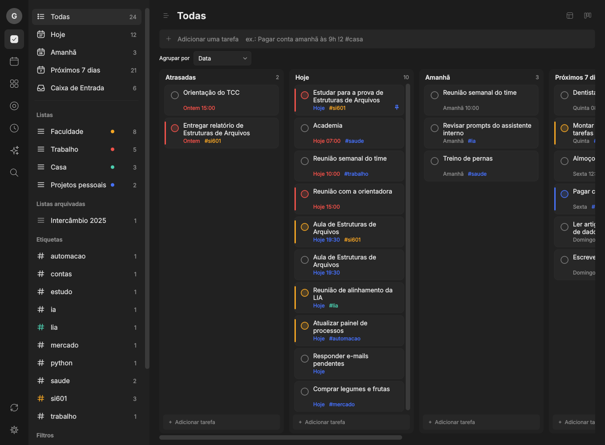
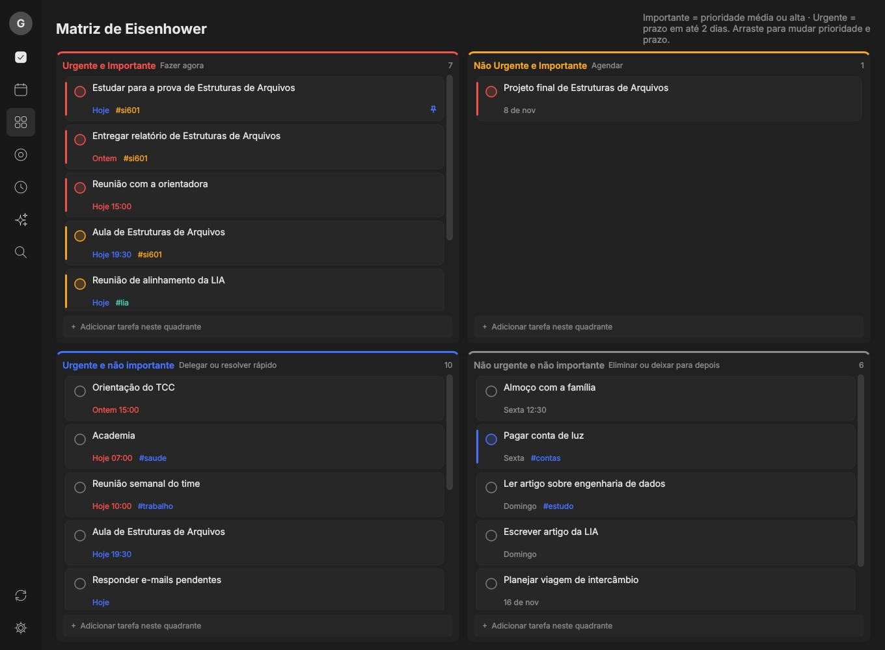
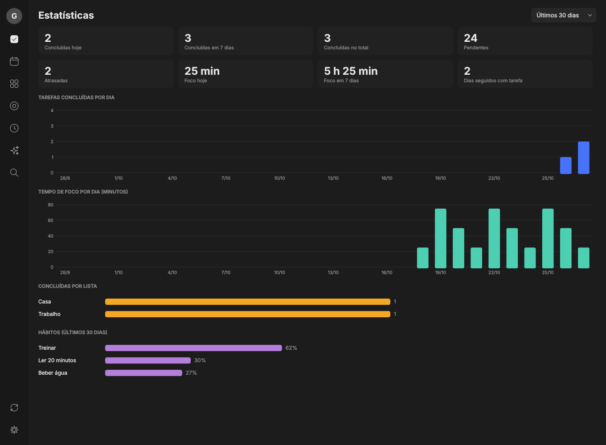
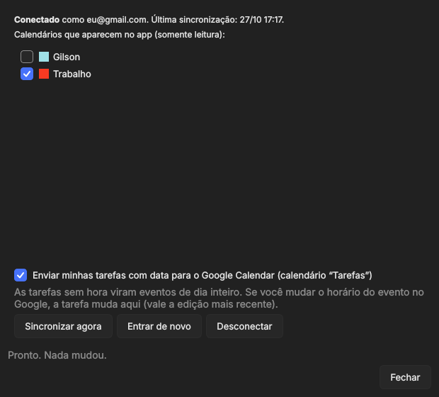

# Norteia

Gerenciador de tarefas para desktop, com calendário, assistente de IA integrado e sincronização com o Google Calendar. Feito em Python (PySide6 + SQLite), com tema escuro, funcionando offline e com os dados na máquina da pessoa.

Criado por Gilson Tavares da Silva para a **LIA, Liga de Inteligência Artificial**. Projeto em desenvolvimento, versão 0.7.

> **English summary:** Norteia is a local-first desktop task manager (Python, PySide6, SQLite) with a full calendar, Google Calendar two-way sync and an AI assistant that reads your tasks and proposes changes as a reviewable plan (apply, then undo). The AI layer is provider-agnostic (Gemini, Claude, ChatGPT, DeepSeek), accepts files and voice, and has 447 automated tests behind it. Source is visible for evaluation only (see `LICENSE`).

## Como ficou

| | |
|---|---|
|  |  |
|  |  |
|  |  |
|  |  |

As capturas usam dados de demonstração e respostas simuladas da IA.

## O que já funciona

**Tarefas**
- Listas, projetos com pastas, etiquetas, filtros salvos e subtarefas em até 5 níveis.
- Visualizações em lista, Kanban e linha do tempo; Matriz de Eisenhower.
- Datas em linguagem natural ("depois de amanhã", "dia 15"), repetição personalizada, lembretes (inclusive constantes até concluir) e janela de aviso com Concluir e Adiar.
- Foco (Pomodoro e cronômetro), hábitos, contagem regressiva e estatísticas.
- Bandeja do sistema, início com o Windows e atalho global para criar tarefa rápida.

**Calendário**
- Dia, semana, mês, ano, agenda, multidia e multisemana, com arrastar e esticar para mudar horário e duração.
- Eventos no mesmo horário se sobrepõem como no Google Agenda.
- Google Calendar nos dois sentidos pela API oficial (login OAuth com PKCE, leitura incremental) e assinatura de calendários por link .ics.

**Assistente de IA**
- Chat que lê tarefas, agenda e estatísticas e propõe mudanças em um **plano**. Nada muda até clicar em "Aplicar tudo", e há "Desfazer".
- Provedores intercambiáveis: Gemini, Claude, ChatGPT e DeepSeek, cada um com a sua chave, guardada no cofre do sistema e exibida só mascarada.
- Anexos (imagem, PDF, Word, texto) e voz com transcrição, respeitando o que cada provedor aceita.

**Sincronização entre aparelhos**
- Servidor próprio e pequeno (FastAPI) que guarda uma cópia; conflitos resolvidos pela edição mais recente; funciona offline.

## Decisões de projeto

- **Núcleo separado da interface.** `norteia/core` contém regras e banco sem nenhuma dependência de Qt e concentra a maior parte dos testes. A interface só chama o serviço.
- **IA atrás de uma abstração.** Cada provedor traduz um histórico neutro para o seu formato (chamada de ferramenta, anexos, erros). Trocar de provedor não muda o assistente.
- **A IA propõe, a pessoa decide.** As ferramentas de escrita geram um plano revisável e reversível em vez de alterar dados diretamente.
- **Privacidade por padrão.** Os dados ficam em SQLite local; as chaves vão para o cofre do sistema (`keyring`); a autorização do Google fica só no computador e não passa pelo servidor de sincronização. A tela de IA avisa que arquivos e áudio vão para o provedor escolhido.
- **Testes sem rede.** Provedores de IA, Google e microfone são simulados nos testes e nas capturas de tela.

## Próximos passos

Ainda **não existe** no projeto (é o plano, não funcionalidade entregue):

- **Gestão de equipe:** tarefas compartilhadas, responsáveis e acompanhamento de projetos entre membros da LIA.
- **Sistema de plugins**, para estender o app com recursos específicos (por exemplo, integração com um Drive compartilhado).
- Atualização automática e tela "Sobre".
- Teste em um Windows real com microfone e provedores de IA de verdade (hoje só com simulações), e instalador publicado em Releases.

## Rodar

Testado com Python 3.13.

    py -m venv .venv
    .venv\Scripts\activate
    pip install -r requirements.txt
    python main.py --demo     # dados de exemplo, não grava nada
    python main.py            # banco real em %USERPROFILE%\.tarefas\tarefas.db

No Windows, sem terminal: `windows\1-abrir-sem-instalar.bat`. Para gerar o executável (PyInstaller) use `windows\2-criar-exe.bat`, e `windows\3-instalador.iss` é o script do Inno Setup.

## Testes e capturas

    python -m pytest                       # 447 testes
    python tools/capturar.py capturas      # telas principais, com dados de demonstração
    python tools/capturar_extras.py capturas   # IA, calendário e integrações

## Documentação

- [`docs/PLANO_IA.md`](docs/PLANO_IA.md): como o assistente funciona, o que falta e limites de segurança.
- [`docs/GUIA_GOOGLE_CALENDAR.md`](docs/GUIA_GOOGLE_CALENDAR.md): como criar o seu projeto no Google Cloud e conectar a agenda.

## Atalhos

Ctrl+N nova tarefa, Ctrl+K busca, Ctrl+B barra lateral, Ctrl+D duplicar, Ctrl+P fixar, Ctrl+Enter concluir, Ctrl+, configurações, F5 sincronizar, Ctrl+1 a Ctrl+8 trocam de tela. Ctrl+Alt+N (global, Windows) abre a caixinha de tarefa rápida.

## Estrutura

    norteia/core     regras e banco (sem interface)
    norteia/sync     servidor FastAPI, cliente e conversão para JSON
    norteia/ui       janela, telas e estilo
    tests/           testes automatizados
    tools/           capturas de tela e gerador de ícone
    windows/         scripts de empacotamento

## Licença

Todos os direitos reservados. O código está visível para consulta e avaliação; veja `LICENSE`.
